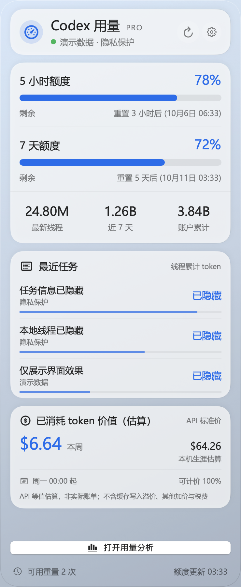
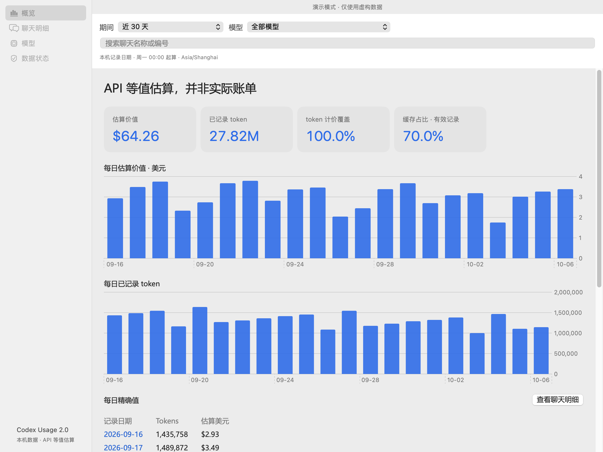
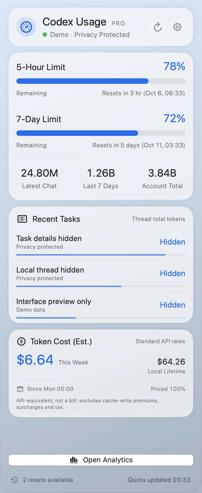
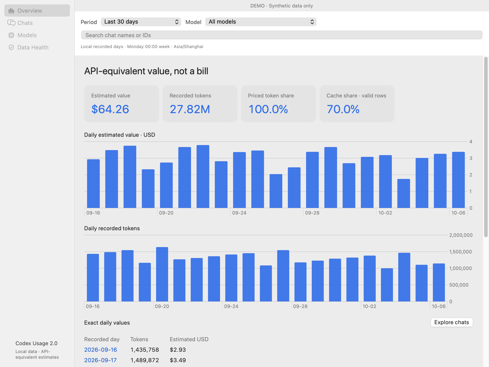

<p align="center"></p>

# Codex Usage Monitor 2.0.1

[中文](#中文) · [English](#english)

**Development candidate — not a newly published release.** The local 2.0.1 (10)
build is ad-hoc signed. Developer ID, notarization, and a signed old-to-new
update test remain release gates. Existing [GitHub releases](https://github.com/ower93/CodexUsageMonitor/releases)
may contain an older version; check its version and release notes.

## 中文

原生 macOS 菜单栏工具：一眼查看 Codex 剩余额度，在独立分析窗口中追溯
「哪个聊天、哪种模型、哪一天」贡献了多少本机 token 和 API 等值估算。
这不是网页，也不是实际账单或已经证实的订阅节省。

<p></p>
<p></p>

截图由实际原生视图和虚构数据生成，不包含真实聊天。上图为展示所有卡片而加高的预览；
菜单面板在较小屏幕上滚动，底部分析入口保持可见。

### 2.0 的重点

- **可信状态：** 额度、账户 token、最近聊天、本机费用分别记录新鲜度。
  连接中、实时、旧数据、不可用和演示模式明确区分；缺失数字显示「—」，不冒充 0。
- **额度兼容：** 优先读取多组额度，支持菜单栏选择额度组及旧单组结构。
  账户「近 7 天」与本机费用「本周」不是同一个口径。
- **原生分析：** 概览、聊天明细、模型、数据状态；日期/模型筛选、搜索、排序、
  父子聊天展开。点击模型或每日数据继续查看相关聊天。
- **费用可解释：** 分类 token、冻结单价/版本、补估记录和异常可检查。
  本周从本机时区周一 00:00 开始；周比较只比较对应完整日，不包含今天。
- **保留历史：** 调价不重算已计价记录。未知模型和新发现的分类异常保持未计价。
  历史冻结估算若有异常则保留并提示，不能静默“修正”过去。
- **本机优先：** JSON 账本保留冻结估算，SQLite 提供可重建的分析投影。
  没有新增云数据库、AI 调用或第三方用量上传。
- **隐私导出：** 默认隐藏聊天名称，支持筛选后的 CSV 和去名称图片。
  隐私模式仍保留日期、模型、token 和金额，不等于全部匿名化。
- **低频后台：** 长连接、事件合并、增量索引、失败退避、睡眠暂停、低电量减频。
  首次大规模索引仍可能短时占用较多 CPU，不能用暖启动表现代替首次启动验收。
- **认证恢复：** 账户接口返回 401 或失效令牌错误时，关闭旧 helper 并自动重连一次。
  重连仍失败会保留其他来源的有效结果；Codex 本身已退出登录时仍须重新登录。
- **桌面体验：** 中英切换、英文常规字重、浅色/深色、卡片设置、登录启动。
  中文优先使用已安装的微软雅黑，否则回退到系统可用中文字体。

### 数据边界

| 内容 | 来源 | 不能代表什么 |
|---|---|---|
| 剩余额度、重置时间 | Codex `account/rateLimits/read` | 不能按 token 数推算订阅额度 |
| 账户近 7 天与累计 token | Codex `account/usage/read`，若版本支持 | 不一定与本机日志范围相同 |
| 最近聊天 | `thread/list` + 本机计数 | 最新聊天不是可靠的当前活跃任务判断 |
| 美元等值估算 | 本机会话日志 + 冻结价格 | 非实际账单，不保证覆盖其他机器或删除的日志 |

应用通过本地 `app-server --stdio` 复用 Codex 登录，不直接读取或导出认证令牌。
Codex helper 自身会正常访问账户服务。不需要新的 API Key。
方法不可用时显示相关来源状态，不填入演示数据。

详见[运行原理](docs/HOW_CODEX_USAGE_MONITOR_WORKS_ZH.md)、
[2.0 验收状态](docs/V2_IMPLEMENTATION.md)和[发布流程](docs/RELEASE_V2.md)。

## English

A native macOS menu bar monitor with an independent analytics window. Check
remaining quota, then explore which chats, models, and recorded days contributed
to locally observed tokens and estimated API-equivalent value.

<p></p>
<p></p>

Previews use synthetic data, not real chats. The expanded menu shows all cards;
the real menu scrolls to fit the available screen.

### What changed

- Independent loading/live/stale/unavailable/demo states and source freshness.
  Missing is not zero.
- Multiple quota buckets, selectable menu quota, and legacy response fallback.
- Native Overview, Chats, Models, and Data Health pages; date/model filters,
  search, sorting, parent/child grouping, charts, and exact record inspectors.
- Monday-at-midnight local weeks. Like-for-like comparisons exclude today from
  both periods. Account Last 7 Days remains a provider-reported metric.
- Input, cached input, and output priced separately. Stored prices and amounts
  remain frozen. New ambiguous or unknown-price records stay unpriced;
  legacy frozen estimates are retained with warnings.
- Local JSON ledger plus rebuildable transactional SQLite analytics projection.
  No new cloud database, model calls, or third-party usage uploads.
- Privacy mode, filtered CSV and name-redacted image export. Amounts, models,
  dates, and counts can still be sensitive; inspect before sharing.
- One reusable app-server connection, coalesced notifications/file events,
  incremental scans, retry backoff, sleep/wake and low-power behavior.
- One bounded reconnect after account authentication errors, reloading the
  current Codex login through a fresh helper. Other successful sources are
  retained if reconnection fails; a genuinely signed-out account needs login.
- Chinese/English, regular English text, light/dark appearance, card visibility,
  and optional Launch at Login.

Quota and account activity come from Codex's app-server using the existing
login. Cost comes from locally available logs, not the account token total.
Other machines, deleted logs, unknown prices, and inconsistent counters can
create coverage gaps. The app does not directly read authentication tokens;
the Codex helper performs its normal account-service access.

This is not an actual bill, guaranteed subscription saving, or official OpenAI product.

## Build and verify

Requires macOS 14+, Xcode tools supporting Swift 6.4, and signed-in Codex for
live data. The verified candidate is Apple silicon; Intel hardware and a clean
second Mac have not been validated.

```bash
# Fixtures do not access the live account by default.
xcrun swift test --scratch-path /tmp/CodexUsageMonitor-build --jobs 2

# Optimized local bundle; does not launch it.
bash script/build_and_run.sh --package

# Explicit demo; does not scan the production usage ledger.
open -n dist/CodexUsageMonitor.app --args --demo --analytics
```

The builder uses an external SwiftPM cache, embeds resources and Sparkle, signs
nested code, and verifies the bundle. Without Developer ID it produces **only
an ad-hoc local build**, not a notarized download. Quit the destination app
before replacing its bundle.

For isolated live QA, set `CODEX_USAGE_DATA_DIR` to a separate data directory
and package with a distinct `CODEX_USAGE_BUNDLE_ID`. Do not point an unreviewed
build at your only production ledger.

Resource checks launch the actual `.app` with Launch Services, require an
existing isolated data directory, and refuse the production data path. They
sample both app and helper memory, app file descriptors, and helper/shutdown
lifecycle. For example:

```bash
mkdir -p /tmp/codex-usage-resource-data
CODEX_USAGE_DATA_DIR=/tmp/codex-usage-resource-data \
  bash script/resource_check.sh 960
```

An empty test directory measures a cold index. Use a copied ledger/index for a
warm run; do not copy Codex credentials. `QA_PROFILE=1` explicitly accelerates
refresh intervals and is not evidence for normal-frequency behavior.

### Sources and pricing

- [Codex app-server reference](https://learn.chatgpt.com/docs/app-server)
- [Official standard API rates](https://developers.openai.com/api/docs/pricing)
- [Versioned bundled catalog](Sources/CodexUsageUI/Resources/pricing-catalog.json)

Catalog checked 2026-10-06. Exact IDs and valid dated snapshots are supported;
unknown tiers are not mapped to cheaper models. Standard short-context estimates
exclude cache-write premiums, long-context/service-tier surcharges and tax.
Stored amounts are not repriced.

Signed catalog imports and Sparkle updates require pinned public keys (plus an
HTTPS feed for Sparkle). No feed or credential is invented for local builds.
See [third-party notices](THIRD_PARTY_NOTICES.md) for the bundled Sparkle license.

### Reproduce privacy-safe previews

```bash
xcrun swift build --scratch-path /tmp/CodexUsageMonitor-build --product PreviewRendererTool
/tmp/CodexUsageMonitor-build/debug/PreviewRendererTool outputs/CodexUsageMonitor-preview.png --full
/tmp/CodexUsageMonitor-build/debug/PreviewRendererTool outputs/CodexUsageMonitor-preview-en.png --full --english
/tmp/CodexUsageMonitor-build/debug/PreviewRendererTool outputs/CodexUsageMonitor-analytics-zh.png --analytics
/tmp/CodexUsageMonitor-build/debug/PreviewRendererTool outputs/CodexUsageMonitor-analytics-en.png --analytics --english
```

Also: `--dark`, `--compact`, `--settings`, `--empty`, `--share-card`.
Demo mode is explicit, never a fallback for real-data failure.
